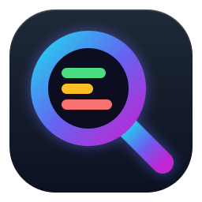

<p align="center">
  
</p>

<h1 align="center">LogLens</h1>

<p align="center">
  <a href="https://github.com/AhmedHamada47/LogLens/releases/latest"></a>
  
  
</p>

A fast, private desktop log viewer for Windows and macOS, built for Serilog-style logs. Drop in a log file and get filtering, search, error summaries and request tracing, all on your own PC.

Built with ASP.NET Core 9 MVC and SQLite, packaged as a desktop app: an installer with a tray icon on Windows, and a drag-to-install `.app` on macOS.

## Download

| Your computer | Download |
| --- | --- |
| **Windows 10 / 11** (64-bit) | **[⬇ LogLens-Setup.exe](https://github.com/AhmedHamada47/LogLens/releases/latest/download/LogLens-Setup.exe)** |
| **Mac with Apple Silicon** (M1 or newer) | **[⬇ LogLens-mac-AppleSilicon.dmg](https://github.com/AhmedHamada47/LogLens/releases/latest/download/LogLens-mac-AppleSilicon.dmg)** |
| **Mac with Intel** | **[⬇ LogLens-mac-Intel.dmg](https://github.com/AhmedHamada47/LogLens/releases/latest/download/LogLens-mac-Intel.dmg)** |

Not sure which Mac you have? Apple menu  → **About This Mac**: "Chip: Apple M…" means Apple Silicon, "Processor: Intel" means Intel.

### Windows

1. Run `LogLens-Setup.exe`. No admin rights are needed.
2. If Windows SmartScreen shows *"Windows protected your PC"*, click **More info → Run anyway** (the app is not code-signed).
3. Double-click the **LogLens** icon on your desktop. It opens in your browser.
4. LogLens keeps running in the **system tray** (near the clock):
   - double-click the tray icon to reopen the page
   - right-click it → **Exit** to close LogLens

Requires Windows 10/11 (64-bit). Nothing else to install; the .NET runtime is included.

### macOS

1. Open the `.dmg` and drag **LogLens** onto **Applications**.
2. Open LogLens from Applications. It opens in your browser.
3. **The first time**, macOS says it can't verify the app (LogLens isn't signed with a paid Apple Developer certificate):
   - click **Done**, then open **System Settings → Privacy & Security**
   - scroll to **Security** and click **Open Anyway** next to "LogLens", then confirm with your password or Touch ID
   - this is needed only once
4. LogLens has no Dock icon; it lives in your browser. Click **Quit LogLens** at the top of the page to close it. Opening LogLens again while it's running just reopens the page.

Requires macOS 12 Monterey or newer. Nothing else to install.

### Updating

- **Windows:** run the newest `LogLens-Setup.exe`. It upgrades in place and keeps all your sessions. If LogLens is running, the installer asks you to close it first.
- **macOS:** quit LogLens, then drag the new version onto Applications and choose **Replace**. Your sessions are kept.

## Using LogLens

1. Click **+ Upload Logs**, then drag and drop a `.log`, `.txt` or `.json` file (up to 500 MB) or paste log text. **Session Name** is optional and defaults to the file name.
2. Click **Parse & Analyze**. A 47 MB log (~216,000 entries) takes a few seconds.
3. In the session view:
   - filter by **ERROR / WARN / INFO**, search text or regex, and limit by time range
   - open **Insights** for the activity timeline and the top errors
   - click a row to open its full message and stack trace, or **[stack]** to open just the stack trace. Opened rows stay open while you scroll.
   - click **Trace** to see every entry from the same request (correlation ID)
   - export the current view as **CSV** or **JSON**

| Key | Action |
| --- | --- |
| `/` | Search |
| `E` / `W` | Show errors / warnings |
| `R` | Reset filters |
| `J` / `K` | Scroll down / up |
| `G` / `Shift+G` | Jump to top / bottom |
| `?` | Show all shortcuts |

### Reading a stack trace

- Each **inner exception** gets its own group, **root cause first**, showing its type and message (*Root cause · inner exception 2*, *Inner exception 1*, *Outer exception*).
- **FAILED HERE** marks the frame where the error was thrown. Start reading there.
- **YOUR CODE** marks the first frame from your own code, so you can skip the framework frames.
- Frames that have a line number show **`File.cs : line N`**, with the full path underneath. Microsoft/System frames never have line numbers in logs, and your own frames only have them when the app was deployed with its `.pdb` files.
- Compiler-generated names are cleaned up: `<DeleteUserAsync>d__14.MoveNext()` shows as `DeleteUserAsync` *(async)*. Hover a frame to see the original line.

Your sessions are stored in `%LOCALAPPDATA%\LogLens\loglens.db` on Windows and `~/Library/Application Support/LogLens/loglens.db` on macOS. Uninstalling keeps them; delete that folder to remove all data.

## Features

- **Big files, fast**: streams the file line by line and bulk-inserts in one SQLite transaction (47 MB in ~4–7 s)
- **Virtual scrolling**: smooth scrolling through hundreds of thousands of rows
- **Smart filtering**: level, time range, text search or regex
- **Request tracing**: follow a correlation ID across related entries
- **Insights**: per-minute activity timeline and top-10 errors
- **Stack trace viewer**: inner exceptions grouped root cause first, "failed here" and "your code" markers, file and line on every frame
- **Streaming export**: CSV or JSON without loading everything into memory
- **Dark / light theme** and **compact** row density
- **Private by design**: listens on `127.0.0.1` only; nothing leaves your PC
- **Single instance**: opening it again just brings up the running app

## Supported log formats

The format is detected automatically from the first lines of the file:

```text
2026-10-21 04:13:37.060 +02:00 [INF] [Source] [CorrelationId:abc] Message   ← Serilog with time zone
2026-10-21 04:13:37 [Information] Source: Message                           ← Serilog without time zone
2026-10-21 04:13:37 ERROR Source - Message                                   ← plain level
[2026-10-21T04:13:37] [WARN] Message                                         ← bracketed
```

Lines without a timestamp are attached to the previous entry (stack traces, long SQL, and so on), up to 500 lines per entry. Short level names such as `INF`, `WRN`, `ERR`, `DBG`, `FTL` and `VRB` are recognized.

## How it works

LogLens is a regular ASP.NET Core MVC web app running inside a small desktop shell for Windows and macOS:

- the app starts a local web server on `http://127.0.0.1:5189` and opens it in your default browser
- **Windows:** `LogLens.exe` is a windowed app (`WinExe`) with a tray icon (`Desktop/TrayIcon.cs`), published **self-contained** and wrapped by an **Inno Setup** installer that adds desktop and Start Menu shortcuts
- **macOS:** the same code is built for `osx-arm64` / `osx-x64` (the tray code is Windows-only), packaged as `LogLens.app` (no Dock icon, closed with the **Quit LogLens** button) inside a `.dmg`
- one project builds both: `-r osx-arm64` / `-r osx-x64` selects the Mac build (see `LogLens.csproj`); anything else builds for Windows

For a full walkthrough (every file, the icon, the installer, the parsing pipeline, and each problem solved along the way), open [Docs/LogLens-Desktop-Guide.html](Docs/LogLens-Desktop-Guide.html). The guide was written for the Windows version; the macOS packaging is described in this README and in `installer/macos/`.

## Development

**Requirements:** .NET SDK 9 or later. Windows for the Windows app; the Mac `.app` / `.dmg` is built on macOS (GitHub Actions does it for you).

```bash
dotnet run
```

The app opens at `http://127.0.0.1:5189`.

```bash
dotnet test LogLens.Tests/LogLens.Tests.csproj
```

### Branches

| Branch | Purpose |
| --- | --- |
| `main` | Current code; releases are tagged from here |
| `Main-Backup` | Snapshot of `main` before macOS support (the v1.0.3 code), kept as a safe restore point |
| `Feature/Apple-Version` | Where macOS support was built and tested before it was merged into `main` |

### Build the installer locally

```bash
winget install JRSoftware.InnoSetup
```

Then run `publish.bat`. It publishes the app and builds `installer/output/LogLens-Setup.exe`.

### Build the Mac app

On a Mac:

```bash
bash installer/macos/build-app.sh osx-arm64 1.1.0
```

Use `osx-x64` for Intel Macs. Output: `installer/output/LogLens-mac-AppleSilicon.dmg` (or `-Intel.dmg`). The app is ad-hoc signed, which is free and needs no Apple account.

On Windows you can check that the Mac version compiles with `dotnet publish LogLens.csproj -c Release -r osx-arm64 --self-contained true`.

### Release a new version

Pick the next version number (for example `v1.1.1`), then:

```bash
git tag -a v1.1.1 -m "LogLens 1.1.1"
git push origin v1.1.1
```

The version is taken from the tag and stamped into the installer. The **Release** GitHub Actions workflow runs the tests, builds the Windows installer and both Mac disk images, starts the Mac app once to check it works, and attaches all three downloads to a **draft** GitHub Release. Download and test the draft, then click **Publish release**. The download link above always points to the newest published release.

### Change the icon

The editable sources are in `Assets/Icon/` (`LogLens.svg` for large sizes, `LogLens-small.svg` for 16–32 px). Export PNGs at 16, 24, 32, 48, 64, 128 and 256 px, pack them into `LogLens.ico`, and rebuild. The exe, shortcuts, tray icon and installer all use it; `wwwroot/favicon.ico` is the browser tab icon. The Mac icon is `Assets/Icon/LogLens.icns`, made from `LogLens-mac-1024.png`.

## Project structure

| Path | Purpose |
| --- | --- |
| `Program.cs` | Startup: single instance, local server, database setup, security headers, browser and tray |
| `Desktop/TrayIcon.cs` | Tray icon (Open / Exit) and startup error dialog |
| `Controllers/` | Dashboard, upload, session view, entries API, trace, export, delete |
| `Services/LogParserService.cs` | Streaming log parser |
| `Data/AppDbContext.cs` | SQLite schema and indexes |
| `Models/` | Sessions, entries and view models |
| `Views/`, `wwwroot/` | Razor pages, CSS and JavaScript (including the virtual scroller) |
| `installer/LogLens.iss` | Inno Setup installer script (Windows) |
| `installer/macos/` | `Info.plist` and `build-app.sh`: builds `LogLens.app` and the `.dmg` (macOS) |
| `.github/workflows/release.yml` | Builds the Windows and Mac downloads into a draft release on `v*` tags |
| `LogLens.Tests/` | xUnit tests for the parser |
| `Assets/Icon/` | Editable SVG sources of the app icon, and the Mac icon (`LogLens.icns`) |
| `Docs/LogLens-Desktop-Guide.html` | Full technical guide (Windows version) |

## Security

- Listens on loopback (`127.0.0.1`) only
- CSRF protection via `[AutoValidateAntiforgeryToken]`
- Content Security Policy, `X-Frame-Options` and `X-Content-Type-Options` headers
- Server-side JSON encoding for all values written into scripts
- Input validation and an upload extension allowlist (`.log`, `.txt`, `.json`)

## Troubleshooting

| Problem | Fix |
| --- | --- |
| "Windows protected your PC" | Click **More info → Run anyway**. |
| macOS: "LogLens" Not Opened / can't be verified | **System Settings → Privacy & Security → Open Anyway** (only the first time). Or in Terminal: `xattr -dr com.apple.quarantine /Applications/LogLens.app` |
| macOS: how do I close LogLens? | Click **Quit LogLens** at the top of the page. |
| A page looks unstyled after updating | Press **Ctrl+F5** once to refresh cached files. |
| "LogLens could not start" | Another program is using port 5189. Close it, or change `DefaultPort` in `Program.cs`. |
| Nothing happens when opening LogLens | It's already running: look for the tray icon, or open `http://127.0.0.1:5189`. |
| A stack trace looks cut short | Logs uploaded with versions before 1.0.3 kept only 20 stack lines. Upload the file again. |
| A frame from my own code has no line number | The app that wrote the log was deployed without its `.pdb` files. Include them in the deployment. |
| The old icon still shows after updating | Windows caches icons. Delete the desktop shortcut and start LogLens from the Start Menu, or sign out and back in. |

## Release history

| Version | Changes |
| --- | --- |
| **1.1.0** | **macOS version** for Apple Silicon (M1 or newer) and Intel Macs, as a `.dmg` with drag-to-install. On Mac, LogLens lives in the browser with a **Quit LogLens** button (no Dock or tray icon). Windows is unchanged. |
| **1.0.3** | Opened log entries stay open while you scroll, with a single scrollbar. Stack traces now show each inner exception as its own group (root cause first) with its type and message, mark where it **failed** and the first frame in **your code**, show `File.cs : line N` on every frame, and number frames without gaps. Long stack traces are kept up to 500 lines (was 20). Fixed: the [stack] button did nothing. |
| **1.0.2** | New modern "Lens" app icon, with simplified artwork for the tray and taskbar, and a matching browser tab icon. Fixed: an empty `[CorrelationId:]` was saved as the ID `:`, which made unrelated entries (startup, background jobs) look like one request in Trace and the correlation filter. Existing sessions are cleaned up automatically on first start. |
| **1.0.0** | First desktop release: Windows installer, desktop icon, tray icon, no console window. Fixed: unstyled pages when launched outside the install folder, upload stuck on "Processing...", and blank rows when scrolling large logs. |

## License

MIT
